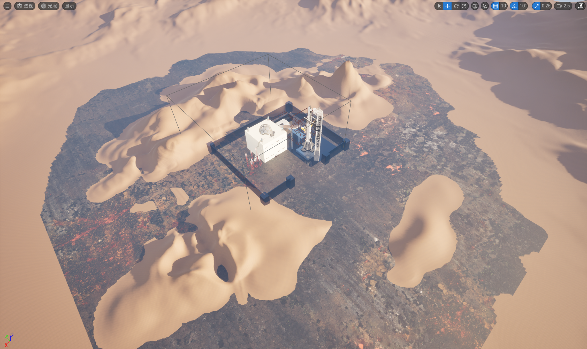

# Anti-Alien — 第 6 关

[English](README.md) · [简体中文](README.zh-CN.md)

**使用 Unreal Engine 制作的团队科幻游戏，包含研究设施探索、沙漠外景、重力变化及火箭发射结尾。**

这里展示我在华威 WM9M5 团队项目第 6 关中的贡献：音频设计与 Blueprint 实现、室外地形和火箭区域关卡工作、配套 UI，以及小组协调。

*图片来自原项目记录。游戏与场景包含团队贡献及第三方素材。*

| 背景 | 内容 |
| --- | --- |
| 原始制作 | 2026 年 4–5 月，华威大学 WM9M5 |
| 团队范围 | 整体项目 42 人；我协调其中的六人小组 |
| 主要工具 | Unreal Engine 5.4、Blueprint、Sound Cue、UMG |
| 个人贡献 | 音频实现、室外布局、火箭区域关卡、UI 和小组协调 |

## 我的贡献

- **可复用音频蓝图：**重构 `BP-MusicManager`，组织音乐切换和淡入淡出；创建 `BFL-AudioHelper`，提供统一的 2D 与位置化音效调用。
- **玩法音频：**参与沙漠环境音、交互与 UI 反馈、发射音效、衰减设置、事件排错和混音平衡。
- **室外与结尾区域：**参与地形编辑、室外布局和火箭区域关卡设计，将最终目标与声音、UI 反馈连接起来。
- **配套 UMG UI：**参与操作提示、目标信息和暂停菜单。
- **六人小组协调：**负责任务分配、进度跟踪、会议沟通和最终整合。

以上描述的是我在团队游戏中的职责。其他成员及第三方创作者也贡献了玩法系统、场景和素材。

## 实现证据

- [`BP-MusicManager` 原始截图](docs/images/music-manager.png)：展示起始音乐淡入、`SwitchMusic` 的淡出／换曲／淡入，以及发射音乐事件。
- [`PlaySFX2D`](docs/images/audio-helper-2d.png) 与 [`PlaySFXAtLocation`](docs/images/audio-helper-positional.png)：展示音效、音量、音高和位置参数的复用方式。

原始报告和截图记录了音乐管理器实现；当前核查的 Level6 源工程导出中有 `BFL-AudioHelper.uasset`，但尚未找到 `BP-MusicManager.uasset`。文档证据与当前源文件可用性分别说明。FMOD 仅为另外的基础练习，不作为本项目的中间件实现。

## 后续 Windows 打包维护

2026 年 10 月，我使用 AI 辅助开发流程整理归档工程并准备 Windows 构建，维护记录包括启动地图、UE／MSVC 编译兼容、飞船组件附加，以及 World Partition 初始化加载。

完整工程修复候选版本打包成功，运行日志未再出现飞船附加失败。精简源仓库独立通过编辑器模块编译与 Cook：**1,627 个资源包、0 错误、3 条原有警告**。这些结果支持构建与启动验证，完整玩法及音频验收仍需另行进行。

测试电脑出现过 DX12 GPU 崩溃，使用 `-dx11` 兼容启动；该路径可能改变部分画面效果。

## 范围与署名

Level 6 表示第 6 关，不是学历等级。2026 年 4–5 月是原始团队制作时间，10 月的打包属于后续维护。

这是课程团队原型。第三方模型、材质、音频等素材保留其原有权利；本作品集不声称整个游戏均由我独立创作，也不对团队或第三方内容授予统一开源许可。

[构建和验证记录](docs/BUILD_AND_VALIDATION.md) · [素材公开范围核对](docs/ASSET_PUBLICATION_REVIEW.md)

本仓库用于非商业作品展示。第三方素材仍适用其原有许可，仓库公开不授予额外的素材再分发权。
